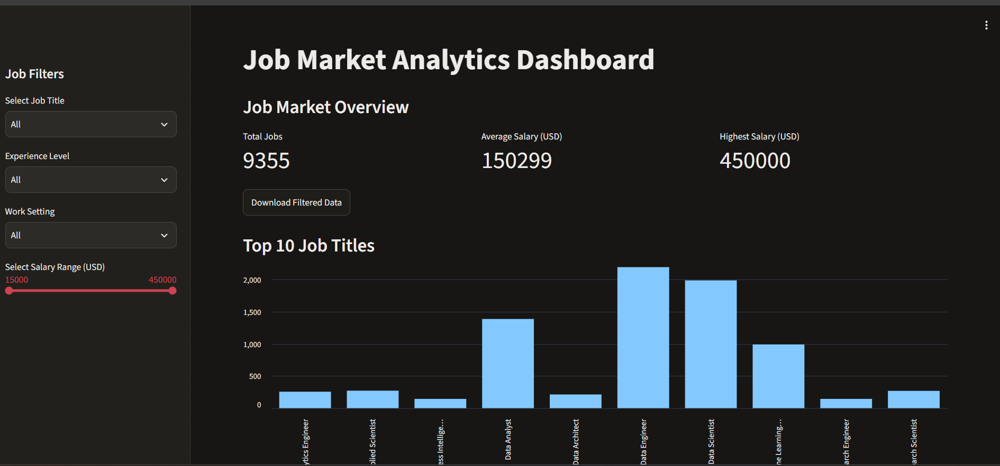

# Job Market Analytics Dashboard

An interactive dashboard to explore job market trends and salary insights using Python, Pandas, and Streamlit.
## Dashboard Preview

## Project Overview
This project analyzes job market data to understand job roles, experience levels, work settings, and salary trends.

## Features
- Total number of jobs
- Average and highest salary in USD
- Top 10 most common job titles
- Average salary by experience level
- Average salary by work setting
- Interactive filters for job title, experience level, work setting, and salary range
- Download filtered data as a CSV file

## Technologies Used
- Python
- Pandas
- Streamlit
- Data Visualization

## Project Files
- `app.py` – Dashboard application code
- `jobs_in_data.csv` – Dataset

## How to Run Locally

1. Install Python.
2. Install the required libraries:

   `pip install streamlit pandas`

3. Keep `app.py` and `jobs_in_data.csv` in the same folder.
4. Run the dashboard:

   `streamlit run app.py`

## Learning Outcomes
- Data handling using Pandas
- Exploratory Data Analysis
- Data visualization
- Building interactive dashboards using Streamlit

## Author
Krish Pant
